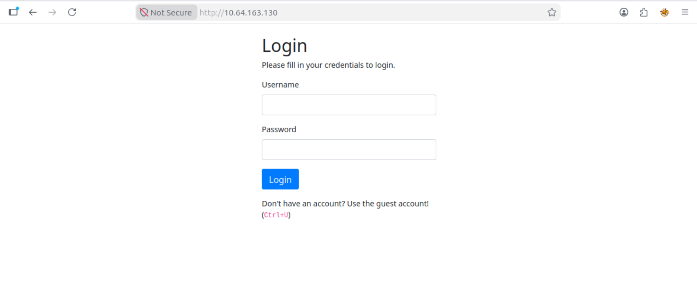
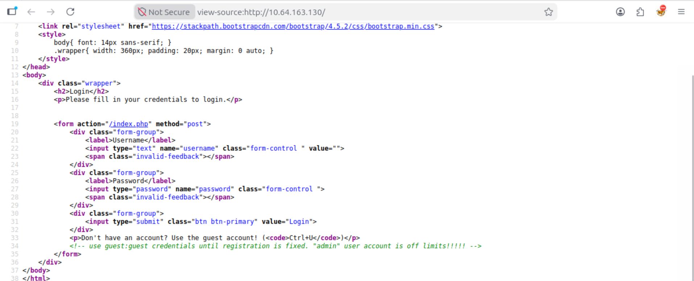

# TryHackMe - Neighbor Challenge

## Overview

The **Neighbor** challenge on TryHackMe is a web security challenge focused on identifying an **Insecure Direct Object Reference (IDOR)** vulnerability.

The objective of the challenge was to investigate the web application, identify weaknesses in its access controls, and use the discovered vulnerability to access information that should not have been available to the current user.

## Objective

- Investigate the web application and its authentication behavior.
- Inspect the application for potentially exposed information.
- Identify an access-control vulnerability.
- Exploit the vulnerability to retrieve the challenge flag.

## Vulnerability

**Insecure Direct Object Reference (IDOR)**

IDOR is an access-control vulnerability that occurs when an application exposes references to internal objects and fails to properly verify whether the current user is authorized to access them.

In this challenge, manipulating information associated with the application's user resources allowed access to data belonging to another user.

## Methodology

### 1. Initial Reconnaissance

I began by navigating to the provided web application.

The application presented a login page requiring a username and password. Since valid credentials were not immediately available, I began investigating the application's client-side information for potential clues.

### 2. Source Code Inspection

I used:

```text
Ctrl + U
```

to inspect the HTML source code of the webpage.

Reviewing the source revealed information that helped me determine how to proceed with accessing the application.

This demonstrated the importance of inspecting client-side source code during web application reconnaissance, as comments or other exposed information may reveal details that were not intended to be visible to users.

### 3. Application Analysis

After gaining access to the application, I examined how the website handled user-specific resources.

I paid particular attention to the URL and the parameters used by the application to determine which user's information was displayed.

This behavior suggested that the application relied on a user-controlled reference to retrieve account information.

### 4. IDOR Identification

I tested whether the user reference could be modified manually.

By changing the relevant value, I was able to request information associated with another user.

The application returned the requested resource without properly verifying whether my current account was authorized to access it.

This confirmed the presence of an **Insecure Direct Object Reference (IDOR)** vulnerability.

### 5. Flag Discovery

After successfully manipulating the object reference, I gained access to information that should have been restricted to another user.

The challenge flag was located within the unauthorized resource, confirming successful exploitation of the vulnerability.

> The flag itself has been omitted from this repository.

---

## Technical Findings

| Finding | Description |
|---|---|
| Vulnerability | Insecure Direct Object Reference (IDOR) |
| Category | Broken Access Control |
| Attack Vector | Manipulation of a user-controlled resource reference |
| Impact | Unauthorized access to another user's information |
| Authentication | Valid low-privileged access could be used to access unauthorized resources |
| Root Cause | Missing or insufficient server-side authorization checks |

## Security Impact

An IDOR vulnerability can allow an authenticated user to access resources belonging to other users by manipulating identifiers or references supplied to the application.

Depending on the affected application, successful exploitation could potentially result in:

- Exposure of sensitive user information
- Unauthorized access to account resources
- Modification or deletion of another user's data
- Privilege escalation
- Broader compromise of application confidentiality

## Remediation

The application should enforce **server-side authorization checks** whenever a user requests access to a protected resource.

The server should verify that:

1. The user is authenticated.
2. The requested resource exists.
3. The authenticated user is explicitly authorized to access that resource.

Applications should never rely solely on URL parameters, object identifiers, or other client-controlled values to determine authorization.

## Lessons Learned

This challenge reinforced the importance of testing **authorization separately from authentication**.

A user being successfully authenticated does not mean that they should automatically have access to every resource available through the application.

I also gained additional practice with:

- HTML source-code inspection
- Web application reconnaissance
- URL and parameter analysis
- Identifying broken access controls
- Testing for IDOR vulnerabilities
- Understanding the difference between authentication and authorization

## Skills Demonstrated

- Web Application Security
- IDOR Testing
- Broken Access Control Analysis
- HTML Source Inspection
- Web Reconnaissance
- Security Documentation
- Vulnerability Analysis

## Evidence

Screenshots documenting the reconnaissance, analysis, vulnerability identification, and successful completion of the challenge are included in this repository.

### 1. Initial Reconnaissance

I began by navigating to the provided web application. The application
presented a login page requiring a username and password.



### 2. Source Code Inspection

I used `Ctrl + U` to inspect the HTML source code of the webpage.

Reviewing the source revealed information that helped me determine how
to proceed with accessing the application.



**Platform:** TryHackMe  
**Challenge:** Neighbor  
**Vulnerability:** Insecure Direct Object Reference (IDOR)  
**Focus:** Web Application Security / Broken Access Control
